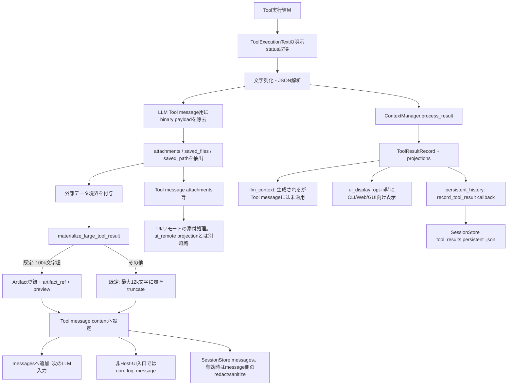

# UAG Context Result Projection 検証レポート

## 1. 結論

**判定：部分的な問題あり（設計との不一致あり）**

Tool Resultのサイズ制限、Artifact化、状態判定、SessionStoreへの結果記録は既存経路で動作しており、関連自動テストはすべて成功した。一方、`ContextResultManager` が生成する `projections.llm_context` はLLMへ送るTool messageに適用されていない。実際のLLM投入は既存の `materialize_large_tool_result()` による別の縮小・Artifact化経路を通る。したがって Result Manager のLLM向け要約・構造化previewは現行の主要Tool経路では実効化されず、設計書§33の三系統projectionとは不一致がある。

また、SessionStoreのTool Result専用テーブルには、バイナリ形状の値は除去される一方、非バイナリの結果本文をサイズ制限・一般的な機密値マスキングなしで保存する経路がある。SessionStoreが有効で、Tool結果に資格情報等が含まれる場合は、永続化ポリシー上の問題となる。

**単純に `materialized_result` を `projections.llm_context` へ置き換える修正は推奨しない。** 現行ではLLM用メッセージを作る前にBase64等を除去し、外部コンテンツ境界を付与し、Artifact化を行っている。Result Managerへ渡されるJSON値はこの加工前の `parsed_tool_result` であり、Managerのsmall projectionはそのJSONをそのまま返すため、機械的置換でBinaryや外部コンテンツ境界を再導入する可能性がある。縮小処理の二重適用やArtifact参照の一貫性も、データ準備とArtifact登録を一元化してから検討すべきである。

**対象リビジョン:** `main` / `9be785b6787e1016c54af259ca9f57612f69758d`（2026-10-12 Merge PR #246）。作業開始時に `origin/main` をfetchして一致を確認。作業ツリーには依頼指示書が未追跡ファイルとして存在していたため、そのファイルは変更していない。コード変更・コミット・PR作成は行っていない。

## 2. データフロー

### `materialized_result` と `projections.llm_context`

- `materialized_result` は `history.py` の既存ヘルパーが作る、**実際の会話履歴・Tool message用の文字列**。既定ではTool結果を最大12,000文字にtruncateし、100,000文字を超える場合はArtifactへ保存して参照とpreviewを返す。Artifact登録失敗時もtruncateへfallbackする。設定で制限を無効化する場合は別途注意が必要。
- `projections.llm_context` は `ContextResultManager` が独立に生成する**Result RecordのLLM向けprojection**。small結果は文字列化した全体、large/hugeはsummary、metadata、Artifact参照、bounded previewを含む。JSONの行・キー構造を保つpreviewも実装されている。
- 現在の `_execute_tool_calls()` は `process_result()` の後で `tool_msg["content"] = materialized_result` とする。`projections.llm_context` をTool messageへセットしていない。したがってLLMへ縮小結果は渡されるが、**Result Managerが生成したLLM projectionによる縮小・summaryではない**。
- Managerへ渡す `record_value` はJSON結果なら `parsed_tool_result`。それに対しmaterializerへ渡すのはBinary除去等の後の `tool_msg["content"]`。入力値・外部コンテンツ境界・Artifact処理時点が異なるため、両者は同じ文字列の別名ではない。

## 3. 検証結果

| 検証対象 | 期待動作 | 実際の動作 | 判定 | 根拠 |
|---|---|---|---|---|
| LLM | Result Managerのbounded projection、summary、参照をTool messageに使用し、巨大出力やBase64を避ける | Tool messageには `materialized_result` を設定。既定ではtruncate/Artifact化により抑制されるが、`projections.llm_context` は未使用。Result Managerの構造化preview・summaryは主要経路でLLMに届かない | **部分的な問題あり** | `llm_flow_helpers.py` 951–997、`history.py` 28–96、`tool_result_manager.py` 114–160, 218–260 |
| UI | UI用projectionと添付参照をUIへ渡し、LLMや永続履歴と分離する | `ui_display` は `UAGENT_SHOW_TOOL_RESULTS` opt-inでCLIへprint、Web/GUIではUI-only assistant messageとして記録される。`ui_remote` は生成・保持されるだけで、`src/`内の消費箇所は見つからない。添付等は `tool_msg` から別途抽出される | **設計接続が部分的** | `llm_flow_helpers.py` 496–531, 931–1038、`tool_result_manager.py` 87–95, 114–160、`web_impl/agent_worker.py` 383–390 |
| 永続履歴 | Result Recordと履歴投影を対応付け、Binary・機密・巨大データを抑制する | opt-in SessionStore callbackは `record_tool_result()` に `persistent_history` を渡す。Binary形状の値は除去されるが、テキスト/JSONの全文を専用の `persistent_json` に保存し、当該保存関数にbyte上限・一般的な資格情報redactionはない。行数pruneはある | **部分的な問題あり** | `llm_flow_helpers.py` 983–997、`tool_result_persistence.py` 35–65、`session_store.py` 1729–1799, 3620–3640 |
| Artifact | 大きな結果のArtifactとResult Record/LLM表示が一貫した参照を持ち、必要時に復元できる | 100k文字超はmaterializerがArtifact化し、その `artifact_ref` をResult Record metadataへ渡す。100k以下はArtifact化せず、既定12kに切られる場合があるが、SessionStore有効時はTool Result専用レコードに全文が残る。実行メッセージのpreviewとpersistent recordは別表現 | **条件付きで成立。統一projectionではない** | `history.py` 58–96、`llm_flow_helpers.py` 951–988、`session_store.py` 1729–1800 |
| Agent State | 成功・失敗・timeout・cancelledを本文のキーワードと区別し、正しく完了/失敗に記録する | `ToolExecutionText`の明示statusがあればそれを優先し、その他は限定的なmarker/構造化結果で判定。`result_status`をRecord metadataおよびState更新へ渡す。PR #246の対象回帰テストは成功 | **確認した範囲で問題なし** | `tool_execution_result.py` 12–26、`llm_flow_helpers.py` 826, 963–1027、`tests/test_agent_state_failure_flow.py` |

## 4. 発見した問題

### 4.1 P2 — LLM向けResult projectionが主要Tool message経路に未接続

- **対象:** `src/uagent/llm_flow_helpers.py:951–997`、`src/uagent/runtime/tool_result_manager.py:114–160, 218–260`
- **再現条件:** 通常のTool callを `_execute_tool_calls()` で処理する。結果は必ず `context_manager.process_result()` に渡されるが、最後にTool messageへ設定されるのは `materialized_result`。
- **原因:** 旧来の `materialize_large_tool_result()` とResult Managerのprojection pipelineが併存し、LLM用messageへの投影元が前者のまま。
- **影響:** Result Managerのsummary、row/key-preserving preview、classification metadataはLLM入力の主経路に反映されない。既定の既存truncate/Artifact処理は動くため、全縮小処理が欠落しているわけではない。
- **最小修正案:** 現段階ではコード変更しない。将来修正する場合、Binary除去・外部コンテンツ境界・Artifact作成・参照付与を行う入力を明確にして、LLM向け縮小を一つの経路だけが所有するようにする。その後、機械的な代入ではなく、既存materializerとの二重処理をなくす小さな変更を設計する。
- **回帰テスト:** `_execute_tool_calls()`統合テストで、small/large/huge文字列、行配列・大きなJSON、Artifact参照、外部データmarker、binaryフィールド、Artifact登録失敗時に、LLMへ実際に渡るTool messageがboundedかつ期待内容か確認する。Result IDとArtifact ID/refも照合する。

### 4.2 P2 — Tool Result専用永続レコードに対する機密値・サイズ抑制が不足

- **対象:** `src/uagent/runtime/tool_result_manager.py:114–160`、`src/uagent/runtime/session_store.py:1729–1799`、`src/uagent/runtime/tool_result_persistence.py:35–65`
- **再現条件:** SessionStoreを有効にし、Toolが資格情報などを含む通常のテキストまたはJSONを返す。`persistent_history` はBinary形状のフィールドのみsanitizeし、`record_tool_result()`はその値を `persistent_json` に保存する。
- **原因:** Session message保存は `redact_sensitive()` を適用するが、Tool Result専用 `persistent_json` はBinary sanitizerのみで保存する。Tool Result専用recordに1件ごとのbyte上限もない。保存後の行数制限は既定最大500件で、レコードサイズを制限しない。
- **影響:** SQLiteの `tool_results.persistent_json` やrecord summaryに、資格情報等の機密値および非常に大きな結果が永続化され得る。これはSessionStore利用時に限る。Raw結果の保存自体は設計上可能だが、設計§33.2のredacted history表現および検証指示の機密・巨大データ抑制と整合しない。
- **最小修正案:** 保存ポリシーを決めたうえで、専用recordにも構造化値のsecret-key redactionとサイズ上限を適用し、必要な完全データは明示的なArtifact保持・参照へ分離する。復元要件と既存履歴互換性を確認するまで、保存形式は変更しない。
- **回帰テスト:** key/value形式の資格情報を含む文字列・辞書、Binaryフィールド、大きなテキストをSessionStoreへ保存し、DBに機密値や上限超過payloadが残らないこと、Artifact参照から必要時に取得できることを確認する。

### 4.3 UI投影について

`ui_display` は明示opt-inのboundedな結果要約として接続されており、現時点で表示専用情報がLLMへ混入する経路は確認できなかった。UI向け全result値のprojection `ui_remote` はRuntimeの共通UI経路には未接続だが、添付・保存先情報はTool messageから別途抽出されるため、これだけで表示欠落とは判定しない。CLI/Web/GUI間での添付挙動とA2A応答は自動テスト・実機で全数確認していない。

## 5. PR構成の推奨

**今回PRは作らない。** 検証指示に従いコード変更・コミット・PR作成を行っていない。

修正する場合は、少なくとも次の2件を分けるのがよい。

1. LLM向けprojectionの適用箇所とArtifact/Binary/外部コンテンツ境界の整合を扱うPR。既存materializerとの二重縮小を避ける。
1. SessionStoreのTool Result専用recordのsecret redaction・サイズ/Artifact保持ポリシーを扱うPR。

UI remote projectionの接続は、Web/GUI/A2Aで望まれるUI契約が確定した場合に限り別途検討する。

## 6. Provider・入口の検証範囲

- **コード確認:** `uagent_llm.py` の共通postambleが `runtime/legacy_tool_continuation.py` を経由して `_execute_tool_calls()` を呼ぶ。Chat Completions系の主要経路とResponses API継続はこの共通処理へ合流する。LM Studio SDK adapterにも共通helperの呼び出しがある。
- **CLI:** 共通処理を利用。`core.show_tool_output` の出力は別の限定・表示経路。
- **Web/GUI:** Web workerは共通LLM処理を実行し、UI-only result表示を別扱いする。GUIはSessionStoreを接続する共通処理を使う。
- **A2A:** `a2a/engine.py` が `uagent_llm.run_llm_rounds()` を呼び出す。
- **Provider実機:** 未実施。OpenAI Responses、Chat Completions各Provider、WebSocket、GUI、A2Aとも外部API・実際の画面・認証情報を使った実機検証はしていない。コード上の共通化を、全Provider・入口での実機保証とはみなさない。

## 7. 実行したテスト

**環境:** Windows、Python 3.14.7、`PYTHONPATH=src`、pytest。各対象を `python -m pytest -q <file> -q` 相当で個別実行。

| テストファイル | 結果 |
|---|---:|
| `tests/test_tool_result_manager.py` | 11 passed |
| `tests/test_tool_result_artifact.py` | 2 passed |
| `tests/test_tool_result_context_limit.py` | 1 passed |
| `tests/test_tool_result_display.py` | 5 passed |
| `tests/test_tool_result_persistence.py` | 4 passed |
| `tests/test_tool_result_retention.py` | 1 passed |
| `tests/test_context_manager_pipeline.py` | 9 passed |
| `tests/test_agent_state_failure_flow.py` | 7 passed |
| `tests/test_tool_result_store.py` | 6 passed |
| `tests/test_tool_result_unicode.py` | 2 passed |
| `tests/test_responses_tool_result_limit.py` | 4 passed |
| `tests/test_agent_state_integration.py` | 2 passed |
| **合計** | **54 passed / 0 failed** |

全テストスイート、全Providerの実機通信、ブラウザ・GUI表示、A2A実サーバー、プロセス再起動後の全Artifact復元は未実施。既存テストはResult Manager自体のprojection生成を検証しているが、`_execute_tool_calls()`が `projections.llm_context` を使うことまでは検証していない。

## 8. 主な根拠

- `src/uagent/llm_flow_helpers.py`: `_tool_result_status()`、`_execute_tool_calls()`のTool message生成・Binary除去・添付抽出・materialization・projection・State更新・UI-onlyログ。
- `src/uagent/runtime/history.py`: Tool result truncate、Artifact threshold、`materialize_large_tool_result()`。
- `src/uagent/runtime/tool_result_manager.py`: Result Record、各projection、LLM bounded preview。
- `src/uagent/runtime/tool_result_persistence.py`: Binary shapeを対象としたhistory sanitizer。
- `src/uagent/runtime/session_store.py`: `append_message()`と`record_tool_result()`の異なる保存処理。
- `src/uagent/runtime/tool_execution_result.py`、`tests/test_agent_state_failure_flow.py`: 明示的成功/失敗statusと本文のエラーらしい文字列を区別する処理。
- `docs/UAG_CONTEXT_MANAGEMENT_DESIGN.md` §3、§33.2: LLM/UI/Persistent Historyの三系統投影設計。
- `docs/plans/IMPLEMENTATION_ROADMAP.md` Context Runtime §32.3: Result Manager投影と `materialized_result` の差を未確認事項として記載。コード確認結果と整合する。
