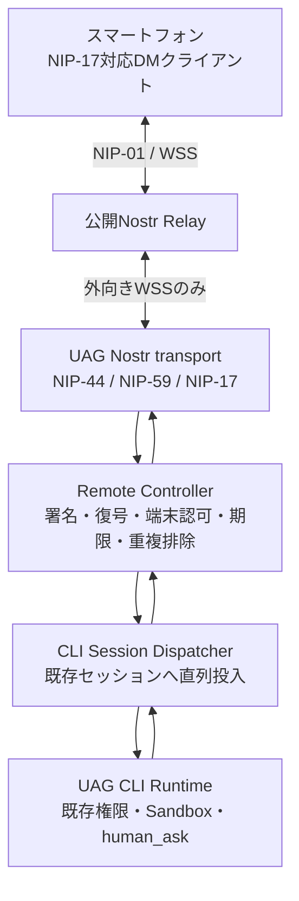

# UAG Nostr Remote CLI 設計（提案）

- 状態: Design Draft / 未実装
- 作成日: 2026-11-09
- 対象: [UAG (agentcli)](https://github.com/awaku7/agentcli)
- 初期対象: **PC上で稼働するUAG CLIの単一セッション**
- 基本方針: **Nostrの既存NIPを優先**し、UAG固有仕様はアプリケーション層だけに限定する

## 1. 目的と非目的

社内・家庭内ファイアウォールの内側で動くUAG CLIを、外部のスマートフォンから安全に操作する。PC側から公開Nostr Relayへ外向きWSS接続を確立するため、原則としてPCへの着信ポート開放や専用中継サーバーを要しない。

初期リリースでは、NIP-17に対応するスマートフォンのNostr DMクライアントとUAG CLI間の**認証済みDM会話**を成立させる。CLIの実行中セッションに対するメッセージ送信、応答、状態確認を先に完成させる。

初期段階では、スマホ専用PWA、GUI/WEB/A2Aの全セッション共有、ファイル転送、独自Relayの常設、GCP Cloud Run functions・AWS Lambdaへの配備、HTTPSフォールバックを実装しない。これらは将来の拡張点として設計する。

重要な制約: **HTTPS/443が許可されていてもWSSが通るとは限らない**。また、企業ネットワークでは外部中継・遠隔操作の利用が組織のポリシーで許可されている必要がある。遮断を迂回する設計は採用しない。

## 2. 現状調査と再利用範囲

2026-11-09時点の主な既存実装:

| 既存の要素 | 現状 | 採用方針 |
|---|---|---|
| [nostr_transport.py](../src/uagent/tools/nostr_transport.py) | WSS複数Relay接続、再接続、NIP-01署名・検証、kind 1/1059送受信 | 接続管理・検証ロジックを共通化 |
| [`_secp256k1.py`](../src/uagent/tools/_secp256k1.py) | Schnorr署名・検証、ECDH | 標準テストベクトルとの照合後に再利用可否を判断 |
| [pybitchat_shared.py](../src/uagent/tools/pybitchat_shared.py) | Nostr受信・BLEブリッジ・LLMへのメッセージ注入 | **遠隔操作の認可経路として直接利用しない** |
| [BITCHAT.md](./BITCHAT.md) | Nostr連携、DM、既存CLIコマンドの説明 | 既存bitchat機能の互換性を維持 |
| UAG CLI会話/セッション機能 | ローカルCLIで会話実行・中断 | 認可済み遠隔入力を既存セッションへシリアライズして投入 |

**現行のkind 1059は標準NIP-17実装とはみなさない。** 宛先指定時にECDH共有鍵とXChaCha20-Poly1305を用いる独自`v2:`形式であり、NIP-44 v2とNIP-59のrumor/seal/gift-wrap構成ではない。宛先なしでは平文イベントを生成する経路もある。これをリモート管理の暗号方式として流用しない。

既存の`:nostr`/bitchatの公開投稿・既存DMの動作は変更せず、新しい`remote`機能を論理的に分離する。既存Nostr鍵や社会的なNostrアカウント鍵をリモート操作用に無条件で兼用しない。

## 3. 採用する標準

| NIP | 役割 | 初期方針 |
|---|---|---|
| [NIP-01](https://github.com/nostr-protocol/nips/blob/master/01.md) | RelayとのEVENT/REQ/OK/EOSE、イベント署名・検証 | **必須** |
| [NIP-44 v2](https://github.com/nostr-protocol/nips/blob/master/44.md) | 標準暗号化ペイロード | **必須**。独自暗号を代用しない |
| [NIP-59](https://github.com/nostr-protocol/nips/blob/master/59.md) | rumor → seal(kind 13) → gift wrap(kind 1059) | **必須** |
| [NIP-17](https://github.com/nostr-protocol/nips/blob/master/17.md) | プライベートDM(kind 14)、受信Relay公開(kind 10050) | **必須**。仕様は現時点でdraft |
| [NIP-19](https://github.com/nostr-protocol/nips/blob/master/19.md) | npub等の表示・入力 | **必須** |
| [NIP-42](https://github.com/nostr-protocol/nips/blob/master/42.md) | Relay側が要求するAUTH | 対応するRelayでは使用 |
| [NIP-40](https://github.com/nostr-protocol/nips/blob/master/40.md) | expirationタグ | 任意で使用。削除保証とは扱わない |

NIP-17の受信Relayはkind 10050で表明する。**送信先は相手のkind 10050に列挙されたRelayに限定**し、情報が取得できない場合は設定・対応状況を案内して送信しない。NIP-42のAUTH成功はRelayへの認証であり、UAG操作の認可にはならない。

NIP-46はリモート署名者向けであり、UAGへの任意のリモート操作を定義するものではないため採用しない。NIP-98は将来のHTTP API認証候補だが、初期のNIP-01/WSS経路では不要。

**標準とUAG独自部分の境界:** Relay上の外側イベント形式・署名・暗号化・DMの配送はNIP準拠。`room_id`、タスクID、操作権限、ACK、失敗応答などは暗号化DMの**内側のアプリケーション・プロトコル**で定義する。独自kindや公開tagにコマンド内容・Room IDを載せない。

## 4. 構成と信頼境界

- Relayは**信頼しない配送経路**。イベントの改ざん・遅延・欠落・重複・収集が可能と仮定する。
- 受信イベントは外側gift wrapの署名を検証し、NIP-44で復号してsealの署名、rumorの著者とsealの著者の一致を検証する。
- **署名検証は認証であり、認可ではない。** sealから検証できた送信者公開鍵を、UAG内のペアリング済み鍵・権限テーブルと照合する。
- 暗号化済みDM内の文面は実行命令として直接評価せず、必ずRemote Controllerで検査してから既存CLIの受付経路に渡す。
- 別スレッドの受信ハンドラーが直接CLIの内部状態やLLMイベントキューを書き換えない。既存の会話実行・キャンセルとの競合を避ける。

## 5. 初期CLI操作（提案）

以下は**新規実装するコマンド案**であり、現行版で動作するコマンドではない。

| CLIコマンド | 用途 |
|---|---|
| `:remote on` | リモート機能を有効化。専用鍵・受信Relay設定を確認して接続 |
| `:remote status` | 接続Relay、専用npub、接続状態、対象CLIセッション、登録端末数 |
| `:remote pair` | スマホのnpubを入力してローカルで端末認可。初期権限を選択 |
| `:remote devices` | 許可した端末・権限・最終接続情報（内容は表示しない） |
| `:remote revoke` | 対話式に対象端末を選び、許可を即時失効 |
| `:remote off` | 受信・送信処理を停止（登録端末情報は残す） |

引数・環境変数の追加を極力避け、初回だけ対話式セットアップを実施する。Relayの既存設定は可能な限り再利用し、remote専用の鍵と受信Relay情報は区別する。**既定値はOFF**。CLIプロセスの終了後も受信する常駐デーモン化は初期対象外。

## 6. ペアリング、端末権限、セッション対応

1. PC側の信頼できるローカルCLIで`:remote on`を実行する。
1. 専用のNostr鍵ペアを生成・安全に保存し、Relayの受信設定（kind 10050）を構成する。
1. スマホのNIP-17対応クライアントからスマホ側の公開鍵（npub）を取得する。リモート管理には専用鍵の利用を推奨。
1. PC側で`:remote pair`を実行し、スマホのnpubを登録する。公開鍵をローカル画面で照合し、ローカル操作者の明示的な承認を必須とする。QRは公開鍵とRelay案内のみを含め、nsecは含めない。
1. 端末に許可する操作範囲を保存する。まず`status`と`chat`、必要に応じて`cancel`/`approve`を分離する。
1. 認可された端末からのDMだけを、`:remote on`時点で紐付けた**CLIの単一セッション**へ転送する。CLI内で会話を切り替えた際は、再バインドをローカルで明示的に行うまでは安全側に停止する。
1. `:remote revoke`後のイベントは、有効な暗号文であっても受理しない。

鍵の登録解除は将来の通信を拒否する操作であり、過去にRelayへ保存された暗号文の確実な削除を意味しない。鍵紛失時の端末再登録とローテーションを想定する。

## 7. DMメッセージと処理フロー

**MVPは標準NIP-17の通常テキストDMをそのまま利用**する。一般的な対応スマホアプリで、特別なUAG用アプリなしに日本語の指示を送って返信を読めることを優先する。

- 通常テキストDM: 認可済み`chat`権限の入力として既存CLI会話へ投入。返信もNIP-17のDMで送る。
- `/uag status`: LLMに渡さず状態を問い合わせる（状態の公開範囲は認可ポリシーに従う）。
- `/uag cancel`: `cancel`権限を持つ端末にのみ許可。既存CLIのキャンセル機構へ渡す。
- `human_ask`応答: `approve`権限のある同一ペア端末だけが、対象要求IDに応答できるようにする。**承認は通常チャット本文と混同しない。**
- より豊富な構造化イベント（Room列挙、進捗ストリーム、タスク結果、ACKの機械可読化）は後段で、kind 14の暗号化本文内にバージョン付きUAGペイロードとして追加する。外側に独自Nostr kindは追加しない。

最初は`chat/status`を優先し、`cancel/approve`は別テストで認可・要求IDバインディングを満たした時だけ有効にする。`chat`から暗黙に`approve`を実行する経路は作らない。

**LLMツールに関する原則:** リモート入力がLLM経由でツール利用につながることも権限昇格として扱う。初期状態ではリモート由来のホスト操作・秘密情報アクセスを許可せず、利用者がローカルで許可したスコープだけを既存UAGのSandbox・human_ask等のポリシーに従って実行する。Nostr接続だけで任意のホストツールを解放しない。

## 8. 配信保証・再実行防止・接続断

- NIP-01の`OK`は**Relayへの受理結果**であり、CLIが処理を完了した証明ではない。
- メッセージ受付状態（受信、検証、受付、実行、返信）を区別し、利用者向けに意味を明記する。
- Relayからの再配送や再接続に備え、復号後の**送信者公開鍵＋rumor ID**をSQLite等に永続化して重複実行を抑止する。複数Relayで受けても1度だけ実行する。
- NIP-59で外側タイムスタンプは意図的に撹乱され得るため、外側の`created_at`で実行期限を判断しない。rumorの時刻・ローカル受信時刻・有効期限のポリシーを評価する。時刻ずれを許容する上限を定め、古い指示を自動実行しない。
- Relayの保存・配送は保証されない。`EOSE`後の差分取得、再接続、受信済み重複排除、返信の再送設計を行う。
- CLIが終了している場合は**後から危険な指示を無条件で実行しない**。MVPは接続中のみ操作可能とし、オフラインの指示には有効期限を設ける。
- 過大なイベント、未知のkind、破損したペイロード、鍵不一致、不正署名、不正な復号は失敗として安全に破棄する。
- 公開Relayの運用規則（容量制限、AUTH、保持期間、検閲・停止）には依存しすぎない。最初は2つ程度のRelayと端末相互接続を検証する。

## 9. セキュリティ要件

**MUST（初期受け入れ条件）**

- リモート専用鍵を生成し、秘密鍵をログ・QR・通信・エクスポート情報に含めない。OSの安全な資格情報ストアを使える場合は活用する。
- NIP-44 v2、NIP-59、NIP-17を公式テストベクトルと相互運用テストで検証し、暗号化・署名検証失敗時はfail closed。
- 外側gift wrapの送信鍵ではなく、復号したsealの認証済み送信者公開鍵を権限確認に使用する。
- ユーザーがPC上で明示的に登録・承認したnpubのみを許可する。許可されていないイベントをCLIプロンプトに投入しない。
- 公開Relayに平文の会話・ツール結果・APIキー・認証情報を投稿しない。kind 1や独自の平文kind 1059をリモート制御に使わない。
- 端末失効、操作範囲、会話セッションとの紐付け、イベントID重複排除、入力サイズ制限、期限判定を持つ。
- 遠隔操作を有効にしても既存CLIの権限・Sandbox・危険操作確認を迂回しない。
- 異常時に秘密情報をログに含めない。監査ログは時刻・鍵の短い識別子・操作種別・結果・拒否理由を優先する。

**限界・前提**

- NIP-44/NIP-17は過去の秘密鍵漏洩に対して完全な前方秘匿性を保証するものではない。
- Relayは外側の受信者`p`タグ等の情報を観測し得る。メタデータ完全秘匿を保証しない。
- NIP-40によるexpirationや削除要求はRelay上のデータ消去を保証しない。
- 外部通信が禁止された企業ネットワークでは利用不可。組織の許可と通信経路の検証が必要。

## 10. 段階的な実装計画

| 段階 | 内容 | 完了条件 |
|---|---|---|
| P0: 標準Transport | NIP-44 v2 / NIP-59 / NIP-17、kind 10050、NIP-01 Relay操作。既存bitchat経路から安全に分離 | 公式ベクトル＋外部実装との暗号化DM相互運用が成立 |
| P1: CLIリモート会話 | `:remote on/off/status/pair/devices/revoke`、端末認可、単一CLIセッション、DM送受信 | スマホのNIP-17対応クライアントから送った会話が同じCLIセッションで処理・返信される |
| P2: 実運用制御 | `status`、中断、human_ask、権限境界、監査、永続的重複排除・再送 | 端末失効・不正指示・重複受信・切断復旧の回帰テスト成功 |
| P3: 拡張 | PWA、複数Room、WEB/GUI/A2A共有、通知 | CLIの認可原則とプロトコルを維持したまま追加可能 |

P0/P1を初回開発対象とする。**初回PRは設計ドキュメントのみ**とし、実装は小さなPRに分割する。既存のpybitchat/nostr利用者に影響する暗号形式の破壊的な一括置換は行わない。

## 11. 検証項目

1. **標準互換**: NIP-44公式テストベクトル、NIP-17/59対応の別実装との往復DM、NIP-42が必要なRelayでのAUTH、kind 10050の配送先制約。
1. **正常系**: CLI起動 → `:remote on` → ローカルペアリング → スマホDM → UAG応答 → `:remote off`。
1. **権限**: 未登録鍵・失効鍵・改ざんイベント・他セッション指定・権限外のキャンセル/承認を拒否。
1. **信頼境界**: 受信文からのツール実行・秘密情報アクセス・`human_ask`承認が認可なしで起きない。
1. **耐障害性**: Relay切断/再接続、2 Relay同時受信、イベント再送、古いイベント、PC再起動、CLI終了時を検証。
1. **プラットフォーム**: Windows / Linux / macOSで鍵保護、WSS・プロキシ、CLI実行が成立。
1. **企業ネットワーク**: 許可されたWSS経路で到達性を実測。禁止環境での回避策実装は行わず、将来の正規HTTP代替経路を別途評価。
1. **既存回帰**: `:nostr`、bitchat、CLI会話、Sandbox、human_askの既存テストが不変。

Python実装PRでは変更部分のBlack整形、`python -m black --check`、Ruff、関連pytestと既存回帰テストを確認し、未実行項目は明示する。CI失敗時はログを確認して原因を修正する。mainへ直接コミットせずブランチ/PRで進める。

## 12. 将来のCloud Functions/HTTPSフォールバック

GCP Cloud Run functionsおよびAWS Lambdaは、**NIP-01標準のWSS Relayをそのまま置き換えるものではない**。WSS禁止環境に対応する必要が確定した場合、NIP-17/59の**署名済み・暗号化済みイベント**を不透明なデータとしてHTTPSで受け渡す別トランスポートを検討する。

このHTTP中継はUAG固有拡張であり、Nostr標準互換と混同しない。クラウド側では復号・LLM処理・任意ツール実行を行わない。導入前に情報持ち出し規定、データ保管、料金、認証、TLSインスペクションの影響を評価する。

## 13. 決定事項・未決定事項

**決定事項**

- 初期はCLIの単一セッションに限定する。
- 公開Nostr Relayを使用できるようにし、専用中継サーバーを必須にしない。
- 通信形式はNIP-01/17/44/59を優先し、独自拡張は暗号化された本文側に限定する。
- 端末ペアリングとローカル許可を必須とし、既定OFFで運用する。
- 既存pybitchatの互換性を維持する。

**実装方針案（レビュー対象）**

以下は初回実装を進めるための具体案。NIP相互運用試験や既存CLIの実装調査で不整合が分かった場合は、実装開始前に更新する。

| 項目 | 初期案 | 根拠・受け入れ条件 |
|---|---|---|
| MVPの操作範囲 | P1は`chat`と`status`のみ。`cancel`と`approve`はP2以降に分離し、P1では常に拒否する | 通常会話と危険な制御・承認の権限境界を混同しない。権限外操作がCLI実行経路に到達しないテストを行う |
| ペアリング | PC上でローカル操作者がスマホのnpubを確認し、明示承認する。P1の端末権限は`chat`/`status`から選択し、未指定は付与しない | Nostr署名の有効性だけで端末登録しない。未登録鍵・失効鍵はプロンプト投入前に拒否する |
| リモートチャットのツール権限 | リモート入力にもローカル入力と同じ既存Sandbox・確認ポリシーを適用する。リモートであることを理由に権限を追加しない。秘密情報アクセスや危険操作は既存ガードで拒否またはローカル確認する | 「chat」権限は会話入力権限であり、ホスト操作・秘密情報閲覧・承認権限を含まない |
| セッション紐付け | `:remote on`時に前面のCLIセッションを固定する。セッション終了・切替を検知したら受付を停止し、ローカル操作者による明示的な再バインドまで再開しない。DMから任意のセッションIDを指定させない | 他セッションへの入力混入を防止する。切替後の入力が旧・新いずれのセッションにも誤投入されないことをテストする |
| 入力形式 | P1ではNIP-17通常テキストをそのまま`chat`入力として扱う。`/uag status`のみ予約コマンドとして厳密に認識し、未知の`/uag ...`は通常チャットへ流さず拒否する | コマンドと自然文の曖昧な解釈を避ける。構造化ペイロード導入時はバージョン付きスキーマを別途定義する |
| 期限・重複排除 | rumorの`created_at`が未来に5分を超える、または受信時点で10分を超えて古い場合は拒否する案とする。送信者公開鍵＋rumor IDをSQLiteに永続化し、検証・認可後、実行投入前に原子的に受付記録を作成する | 外側gift wrapの時刻は期限判定に使わない。10分・5分は初期値案で、端末時計ずれ・Relay遅延を相互運用試験で確認して調整する。重複イベントは複数Relayから届いても1回しか投入しない |
| ACK・返信 | RelayのNIP-01 `OK`とUAGの処理状態を別々に表示する。返信は処理状態（受付／完了／拒否／失敗）を明記し、未送信返信はローカル永続キューで再送する。オフライン受信指示を後から実行しない | `OK`をCLI処理完了の証拠にしない。再送で同一処理を再実行しない |
| Relay設定・障害 | 初期は利用者が選んだ2つ程度のRelayを設定し、受信はUAG側の設定Relay、送信は相手のkind 10050に列挙されたRelayに限定する。kind 10050を取得できない・送信先が空の場合は送信せず理由を通知する。全Relay切断中は新規操作を受け付けない | Relayは信頼せず、各Relayの到達性・AUTH要否を個別に扱う。配送成功・相手アプリでの受信を保証しない |
| 鍵保管・復旧 | 専用秘密鍵はOS資格情報ストア（Windows Credential Manager、macOS Keychain、Linux Secret Service等）を優先する。利用可能な安全な保管先がない場合は`:remote on`を有効化せず、平文保存へ自動フォールバックしない。鍵紛失時は新規鍵を生成し、全端末をローカルで再ペアリングする | nsecをログ・環境変数・QR・エクスポートに含めない。バックアップ方式は各OSの安全な保管機構を前提に別途明示する |
| 監査・プライバシー | 操作時刻、送信者鍵の短い識別子、操作種別、受付結果・拒否理由を記録する。DM本文、復号済みペイロード、秘密鍵、ツール引数・結果は通常ログに記録しない | 監査ログだけで認可判断を再現できる範囲を保ちつつ、会話内容や秘密情報の複製を避ける |

**既存CLIとの接続候補（コード調査結果）**

- `src/uagent/cli_impl/stdin_loop.py`はローカル入力を`core.event_queue`へ`user`/`command`イベントとして投入し、`src/uagent/cli_impl/main.py`のメインループが順次処理する。遠隔入力も新規の型付きイベントとして同じメインループに渡し、受信スレッドから`messages`やLLM実行関数を直接操作しない。
- 遠隔イベントには内部生成の送信者鍵、rumor ID、受信時刻、`:remote on`時の期待セッションIDを付与する。メインループが処理する時点で有効化状態・権限・期限・現在の`core.session_id`との一致を再確認し、拒否理由を返信する。イベント投入後に`:sessions load`等でセッションが切り替わった場合も、旧セッション宛てのイベントを新セッションへ流さない。
- `core.event_queue`はLLM処理中に消費されないため、キュー投入は実行・完了を意味しない。キュー滞留中に期限切れまたはセッション変更となったイベントは、実行直前に拒否する。未処理イベント数と保持時間に上限を設ける。
- `human_ask`は`core.human_ask_queue`を使う別の応答経路で、CLIでは`stdin_loop.py`がローカル端末入力をそのキューへ渡す。通常の遠隔チャットをこのキューへ流して承認・回答として扱うことは禁止する。P1では遠隔`approve`を実装せず、`human_ask`中に届いたチャットは保留せず`busy`として拒否する案とする。

**実装前に検証して確定する事項**

- 採用するNIP-17ライブラリがNIP-44 v2公式テストベクトル、NIP-59 gift-wrap、NIP-17 kind 14/10050を満たすこと。満たさない場合は独自暗号実装で補わず、別ライブラリまたは実装計画を再検討する。
- 想定するスマートフォンDMクライアントとの送受信・kind 10050取得・Relay指定の相互運用性。検証対象アプリとバージョンをテスト計画に記録する。
- CLIランタイムにおけるセッション固定、直列投入、終了・切替通知、キャンセル、human_askの既存APIと、ローカル確認を維持できる接続点。
- 5分の未来許容幅・10分の最大メッセージ年齢、SQLiteの保持期間、返信再送上限を実機試験で確認する。保持期間を過ぎた重複排除記録を削除する場合も、古いイベントを再実行しない期限ポリシーを維持する。
- 初期Relayの可用性目標と、全Relay停止・相手のkind 10050未設定・返信送信失敗時に表示する利用者向け文言。

## 14. 参照

- [Nostr NIPs: official repository](https://github.com/nostr-protocol/nips)
- [NIP-01 Basic protocol](https://github.com/nostr-protocol/nips/blob/master/01.md)
- [NIP-17 Private Direct Messages](https://github.com/nostr-protocol/nips/blob/master/17.md)
- [NIP-44 Encrypted Payloads](https://github.com/nostr-protocol/nips/blob/master/44.md)
- [NIP-59 Gift Wrap](https://github.com/nostr-protocol/nips/blob/master/59.md)
- [NIP-42 Relay Authentication](https://github.com/nostr-protocol/nips/blob/master/42.md)
- [UAG existing Nostr transport](../src/uagent/tools/nostr_transport.py)
- [UAG pybitchat integration](./BITCHAT.md)
