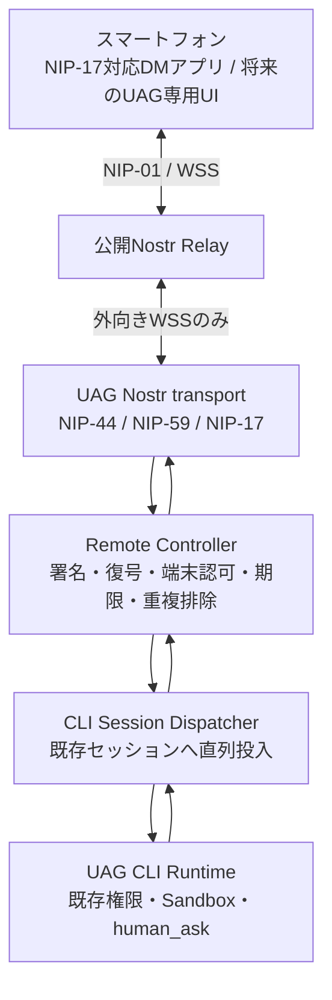

# UAG Nostr Remote CLI 設計（提案）

- 状態: Design Draft / 未実装
- 作成日: 2026-11-09
- 対象: [UAG (agentcli)](https://github.com/awaku7/agentcli)
- 初期実装対象: **PC上で稼働するUAG CLI**。スマートフォンは同じUAGを操作するリモート端末
- 基本方針: **Nostrの既存NIPを優先**し、UAG固有仕様はアプリケーション層だけに限定する

## 1. 目的と非目的

社内・家庭内ファイアウォールの内側で動くUAG CLIを、外部のスマートフォンから安全に操作する。PC側から公開Nostr Relayへ外向きWSS接続を確立するため、原則としてPCへの着信ポート開放や専用中継サーバーを要しない。

**最終的な受け入れ条件は、ペアリング済みスマートフォンからPCのUAG CLIで可能な操作を同等に行えること。** LLM会話だけでなく、全CLIコマンド、ツール/MCP/Skill、会話・セッション切替、実行状況と出力の取得、中断、`human_ask`の確認・回答、ファイルや成果物の送受信まで含める。実際のツール・ファイル・プロセスはPC上で扱い、スマートフォン側へUAG実行環境を複製しない。

実装は段階的とする。最初にNIP-17対応スマートフォンアプリとの認証済みDM会話を成立させ、その後、**PC版CLIの機能を削らずに**コマンド・セッション・確認・成果物を順次追加する。「最初はchat/statusだけ」は実装途中の検証範囲であり、製品仕様としての制限ではない。

PC上の実行対象は当面CLIのみとする。スマホ側は既存のNIP-17対応Nostrアプリでテキスト操作を開始する。ただし一般的なNostrアプリでCLIの全表示・対話・ファイル操作まで再現できるわけではないため、**機能同等性を完了させる段階ではNostr通信を内蔵したUAG向けスマホWeb/PWA等の専用UIが必要になり得る**。GUI/WEB/A2A側の実行セッション対応、専用Relay、GCP Cloud Run functions・AWS Lambda、HTTPSフォールバックは後続スコープとする。

重要な制約: **HTTPS/443が許可されていてもWSSが通るとは限らない**。また、企業ネットワークでは外部中継・遠隔操作の利用が組織のポリシーで許可されている必要がある。遮断を迂回する設計は採用しない。

## 2. 現状調査と再利用範囲

2026-11-09時点の主な既存実装:

| 既存の要素 | 現状 | 採用方針 |
|---|---|---|
| [nostr_transport.py](../src/uagent/tools/nostr_transport.py) | WSS複数Relay接続、再接続、NIP-01署名・検証、kind 1/1059送受信 | 接続管理・検証ロジックを共通化 |
| [`_secp256k1.py`](../src/uagent/tools/_secp256k1.py) | Schnorr署名・検証、ECDH | 標準テストベクトルとの照合後に再利用可否を判断 |
| [pybitchat_shared.py](../src/uagent/tools/pybitchat_shared.py) | Nostr受信・BLEブリッジ・LLMへのメッセージ注入 | **遠隔操作の認可経路として直接利用しない** |
| [BITCHAT.md](./BITCHAT.md) | Nostr連携、DM、既存CLIコマンドの説明 | 既存bitchat機能の互換性を維持 |
| UAG CLI会話/セッション機能 | ローカルCLIで会話実行・中断 | 認可済み遠隔入力を既存セッションへシリアライズして投入 |

**現行のkind 1059は標準NIP-17実装とはみなさない。** 宛先指定時にECDH共有鍵とXChaCha20-Poly1305を用いる独自`v2:`形式であり、NIP-44 v2とNIP-59のrumor/seal/gift-wrap構成ではない。宛先なしでは平文イベントを生成する経路もある。これをリモート管理の暗号方式として流用しない。

既存の`:nostr`/bitchatの公開投稿・既存DMの動作は変更せず、新しい`remote`機能を論理的に分離する。既存Nostr鍵や社会的なNostrアカウント鍵をリモート操作用に無条件で兼用しない。

## 3. 採用する標準

| NIP | 役割 | 初期方針 |
|---|---|---|
| [NIP-01](https://github.com/nostr-protocol/nips/blob/master/01.md) | RelayとのEVENT/REQ/OK/EOSE、イベント署名・検証 | **必須** |
| [NIP-44 v2](https://github.com/nostr-protocol/nips/blob/master/44.md) | 標準暗号化ペイロード | **必須**。独自暗号を代用しない |
| [NIP-59](https://github.com/nostr-protocol/nips/blob/master/59.md) | rumor → seal(kind 13) → gift wrap(kind 1059) | **必須** |
| [NIP-17](https://github.com/nostr-protocol/nips/blob/master/17.md) | プライベートDM(kind 14)、受信Relay公開(kind 10050) | **必須**。仕様は現時点でdraft |
| [NIP-19](https://github.com/nostr-protocol/nips/blob/master/19.md) | npub等の表示・入力 | **必須** |
| [NIP-42](https://github.com/nostr-protocol/nips/blob/master/42.md) | Relay側が要求するAUTH | 対応するRelayでは使用 |
| [NIP-40](https://github.com/nostr-protocol/nips/blob/master/40.md) | expirationタグ | 任意で使用。削除保証とは扱わない |

NIP-17の受信Relayはkind 10050で表明する。**送信先は相手のkind 10050に列挙されたRelayに限定**し、情報が取得できない場合は設定・対応状況を案内して送信しない。NIP-42のAUTH成功はRelayへの認証であり、UAG操作の認可にはならない。

NIP-46はリモート署名者向けであり、UAGへの任意のリモート操作を定義するものではないため採用しない。NIP-98は将来のHTTP API認証候補だが、初期のNIP-01/WSS経路では不要。

**標準とUAG独自部分の境界:** Relay上の外側イベント形式・署名・暗号化・DMの配送はNIP準拠。`room_id`、タスクID、操作権限、ACK、失敗応答などは暗号化DMの**内側のアプリケーション・プロトコル**で定義する。独自kindや公開tagにコマンド内容・Room IDを載せない。

## 4. 構成と信頼境界

- Relayは**信頼しない配送経路**。イベントの改ざん・遅延・欠落・重複・収集が可能と仮定する。
- 受信イベントは外側gift wrapの署名を検証し、NIP-44で復号してsealの署名、rumorの著者とsealの著者の一致を検証する。
- **署名検証は認証であり、認可ではない。** sealから検証できた送信者公開鍵を、UAG内のペアリング済み鍵・権限テーブルと照合する。
- 暗号化済みDM内の文面は実行命令として直接評価せず、必ずRemote Controllerで検査してから既存CLIの受付経路に渡す。
- 別スレッドの受信ハンドラーが直接CLIの内部状態やLLMイベントキューを書き換えない。既存の会話実行・キャンセルとの競合を避ける。

## 5. 初期CLI操作（提案）

以下は**新規実装するコマンド案**であり、現行版で動作するコマンドではない。

| CLIコマンド | 用途 |
|---|---|
| `:remote on` | リモート機能を有効化。専用鍵・受信Relay設定を確認して接続 |
| `:remote status` | 接続Relay、専用npub、接続状態、対象CLIセッション、登録端末数 |
| `:remote pair` | スマホのnpubをローカルで確認・登録し、PCと同等のCLI操作権限（full-control）を明示的に許可 |
| `:remote devices` | 許可した端末・権限・最終接続情報（内容は表示しない） |
| `:remote revoke` | 対話式に対象端末を選び、許可を即時失効 |
| `:remote off` | 受信・送信処理を停止（登録端末情報は残す） |

引数・環境変数の追加を極力避け、初回だけ対話式セットアップを実施する。Relayの既存設定は可能な限り再利用し、remote専用の鍵と受信Relay情報は区別する。**既定値はOFF**。CLIプロセスの終了後も受信する常駐デーモン化は初期対象外。

## 6. ペアリング、端末権限、セッション対応

1. PC側の信頼できるローカルCLIで`:remote on`を実行する。
1. リモート専用のNostr鍵ペアを安全に生成・保存し、Relayの受信設定（kind 10050）を構成する。
1. スマホのNIP-17対応クライアントから公開鍵（npub）を取得する。普段の公開Nostrアカウントではなく遠隔操作専用鍵を推奨する。
1. PC側の`:remote pair`で送信者npubを表示・照合し、ローカル操作者が**full-control**を明示的に許可する。QRは公開鍵とRelay案内のみを含み、nsecを含めない。
1. ペアリング後は**ローカルCLIと同じ権限・Sandbox設定・確認ポリシー**をリモート入力にも適用する。遠隔であることだけを理由に`chat/status`へ制限したり、ツール/MCPを一律禁止したりしない。ペアリング自体は既存の実行確認を回避する権限ではない。
1. スマホからのコマンド・会話・セッション変更を、既存CLIと**同じ処理経路**へ型付きイベントとして直列投入する。ペアリング済み鍵を検証した上で、送信者がアクセスできる対象セッションに限って操作を許可する。セッション変更時にもキュー内イベントの宛先を検証し、他セッションへ誤投入しない。
1. `:remote revoke`で端末の権限を直ちに失効させる。紛失・盗難を想定した鍵ローテーションを行えるようにする。

利用者が明示的に設定したアクセス範囲では、**スマホの承認とPCの承認は同じ意味を持つ**。通常の会話文を承認と解釈することは禁止し、`human_ask`の要求IDに対応した明示的な回答イベントで処理する。全権限を与える対象は、本人が管理する少数の端末に限定する。

CLIの単一セッションから実装を始めることは可能だが、**同等操作の完成条件にはセッション一覧・切替・復元が含まれる**。操作ごとの実行先セッションIDは内部で検証する。DMの任意テキストを、権限確認せず任意のセッションIDとして扱わない。

鍵の登録解除は将来の操作を拒否する処理であり、Relayに保存された暗号文の削除を保証するものではない。

## 7. DMメッセージと処理フロー

**NIP-01 / NIP-17 / NIP-44 / NIP-59は通信層で準拠**し、CLI操作固有の情報は復号したDM本文内にのみ置く。スマホからの入力は「LLMへの文章」だけではなく、通常のCLIコマンドや独立した制御イベントにも対応する。

| PC側CLIの機能 | スマホからの同等操作 | 実装上の要点 |
|---|---|---|
| 通常会話、LLM応答 | NIP-17のテキストDMで入出力 | 同じ会話履歴に追加。返信元・セッションIDを紐付ける |
| CLIの`:`コマンド全般 | コマンド専用入力として明示的に送信 | LLMへの自然文入力と分離。既存コマンド受付と権限・確認処理を再利用 |
| MCP / Skill / サブエージェント / ツール | 同じCLIセッションから呼び出し | リモート用の縮小ツールセットを作らない。既存ポリシーを継承 |
| セッション一覧・切替・復元 | セッション操作イベント | 送信者・宛先・権限を検査し、切替中の競合を直列化 |
| 処理状況・逐次ログ・結果 | CLI出力イベントを購読・受信 | 順序番号、再接続後の追跡、容量制限、機密情報の取扱い |
| 中断・キャンセル | 実行中タスクIDを指定して中断 | 対象ジョブの所有・実行状態を検証。重複キャンセルを安全に扱う |
| `human_ask` / 危険操作の確認 | 要求ID付きの確認内容を受信し、スマホから回答 | 本文の通常チャットと混同しない。PCローカルでしか回答できない制限を残さない |
| ファイル・成果物 | ファイル送受信、一覧、ダウンロード | NIP-17自体に任意バイナリ転送の標準機能はない。別途、暗号化と権限検証を満たす転送方式を選定 |
| 設定変更等のCLI操作 | 同じコマンドとして処理 | 既存の確認・監査・Sandboxが適用される |

### 一般NostrアプリのMVPテキスト表現

既存のNIP-17対応スマホアプリとの初期相互運用のため、以下の**UAGアプリケーション層のテキスト操作**を用意する。これはNIP独自拡張ではなく、暗号化DMの本文表現である。

- 通常のテキスト: LLM会話入力
- `/uag status`: 現在の実行状態・処理中ジョブ等を取得
- `/uag cmd :<cli-command>`: 既存CLIコマンドを実行（非対応・禁止操作は明示的に返す）
- `/uag sessions`、`/uag switch <session-id>`: セッション一覧・切替（後段で有効化）
- `/uag cancel <task-id>`: 指定タスクの中断
- `/uag answer <request-id> <response>`: `human_ask`への明示的応答
- 不明な`/uag`コマンドはLLMに流さずエラーを返す。通常チャットを`human_ask`への承認とは扱わない。

**テキストDMだけでは操作UIの完全一致は保証できない。** PCの画面やストリームを丸ごと転送するのではなく、CLIランタイムの状態を明示的なイベントに変換する。複数出力・対話フォーム・ファイル操作を実用的に提供するには、NIP-17互換のUAGモバイルクライアント（Web/PWA等）が必要になる可能性がある。

将来の専用クライアントでは、暗号化されたNIP-17本文内にバージョン付き型付きペイロードを使用する。リクエストID、セッションID、イベント種別、順序番号、要求期限などを規定し、既存の標準Nostrイベント外形は変更しない。一般DMアプリで読めない構造化操作は自動送信しない。

### 権限境界

**端末ペアリングで本人のfull-controlを承認した場合、スマホからの実行可能範囲は同じPC上のCLI利用者と一致させる。** ローカルCLIでツールが使用可能なら、同じセッションのスマホ操作でも使用できる。既存のSandboxや危険操作確認を飛ばすわけではない。確認が必要なら要求を暗号化DMでスマホへ送り、対応する`human_ask`にだけ回答を受け付ける。PCのキーボード入力しか受け付けない実装は修正対象とする。

公開Relayで暗号化DMを受信できたという事実だけでは、権限は発生しない。ペアリング・本人所有・端末失効・セッションID検査・期限・重複排除はすべて維持する。

## 8. 配信保証・再実行防止・接続断

- NIP-01の`OK`は**Relayへの受理結果**であり、CLIが処理を完了した証明ではない。
- メッセージ受付状態（受信、検証、受付、実行、返信）を区別し、利用者向けに意味を明記する。
- Relayからの再配送や再接続に備え、復号後の**送信者公開鍵＋rumor ID**をSQLite等に永続化して重複実行を抑止する。複数Relayで受けても1度だけ実行する。
- NIP-59で外側タイムスタンプは意図的に撹乱され得るため、外側の`created_at`で実行期限を判断しない。rumorの時刻・ローカル受信時刻・有効期限のポリシーを評価する。時刻ずれを許容する上限を定め、古い指示を自動実行しない。
- Relayの保存・配送は保証されない。`EOSE`後の差分取得、再接続、受信済み重複排除、返信の再送設計を行う。
- CLIが終了している場合は**後から危険な指示を無条件で実行しない**。MVPは接続中のみ操作可能とし、オフラインの指示には有効期限を設ける。
- 過大なイベント、未知のkind、破損したペイロード、鍵不一致、不正署名、不正な復号は失敗として安全に破棄する。
- 公開Relayの運用規則（容量制限、AUTH、保持期間、検閲・停止）には依存しすぎない。最初は2つ程度のRelayと端末相互接続を検証する。

## 9. セキュリティ要件

**MUST（初期受け入れ条件）**

- リモート専用鍵を生成し、秘密鍵をログ・QR・通信・エクスポート情報に含めない。OSの安全な資格情報ストアを使える場合は活用する。
- NIP-44 v2、NIP-59、NIP-17を公式テストベクトルと相互運用テストで検証し、暗号化・署名検証失敗時はfail closed。
- 外側gift wrapの送信鍵ではなく、復号したsealの認証済み送信者公開鍵を権限確認に使用する。
- ユーザーがPC上で明示的に登録・承認したnpubのみを許可する。許可されていないイベントをCLIプロンプトに投入しない。
- 公開Relayに平文の会話・ツール結果・APIキー・認証情報を投稿しない。kind 1や独自の平文kind 1059をリモート制御に使わない。
- 端末失効、操作範囲、会話セッションとの紐付け、イベントID重複排除、入力サイズ制限、期限判定を持つ。
- ペアリングしたfull-control端末は**ローカルCLIと同等の操作権限**を持つが、既存CLIのSandbox・危険操作確認・監査を迂回しない。要求・回答は一意のIDで束縛する。
- CLIの出力・設定・ファイルに機密情報が含まれる場合、正規の権限を持つスマホへ転送し得ることをペアリング時に明示する。Relay上では暗号化し、未認可端末に返さない。
- 異常時に秘密情報をログに含めない。監査ログは時刻・鍵の短い識別子・操作種別・結果・拒否理由を優先する。

**限界・前提**

- NIP-44/NIP-17は過去の秘密鍵漏洩に対して完全な前方秘匿性を保証するものではない。
- Relayは外側の受信者`p`タグ等の情報を観測し得る。メタデータ完全秘匿を保証しない。
- NIP-40によるexpirationや削除要求はRelay上のデータ消去を保証しない。
- 外部通信が禁止された企業ネットワークでは利用不可。組織の許可と通信経路の検証が必要。

## 10. 段階的な実装計画

| 段階 | 内容 | 完了条件 |
|---|---|---|
| P0: 標準Transport | NIP-44 v2 / NIP-59 / NIP-17、kind 10050、NIP-01 Relay操作。既存bitchat経路から分離 | 公式ベクトル＋外部実装との暗号化DM相互運用が成立 |
| P1: CLI接続・会話 | `:remote on/off/status/pair/devices/revoke`、端末認可、CLI単一セッション、NIP-17会話 | スマホから同じCLIセッションへDM送信・応答可能。**機能同等性の完成とはみなさない** |
| P2: CLI機能同等性 | 全CLIコマンド、ツール/MCP/Skill、セッション一覧・切替、途中経過、中断、`human_ask`回答、成果物アクセス、必要な双方向ファイル転送 | **ペアリング済みスマホからPC版CLIの全操作を等価に実行・確認できる** |
| P3: クライアント拡張 | 必要ならNostr対応UAGモバイルWeb/PWA、GUI/WEB/A2Aセッション対応、通知・操作性向上 | P2の機能を維持しつつモバイルUIを改善 |

P0/P1は実装・相互運用の初期マイルストーンであり、`chat/status`への機能制限を仕様として固定しない。P2が今回の要求の完了条件。一般的なNostr DMアプリでは表示・添付ファイル機能が不足し得るため、P2達成に必要な最小限の専用モバイルUIはP2に取り込む。P3はUIの追加改善と他ホストへの拡張に限定する。

既存のpybitchat/nostr利用者に影響する暗号形式の破壊的な一括置換はしない。実装PRは機能単位に分割し、mainに直接コミットしない。

## 11. 検証項目

1. **標準互換**: NIP-44公式テストベクトル、NIP-17/59対応の別実装との往復DM、NIP-42が必要なRelayでのAUTH、kind 10050の配送先制約。
1. **正常系**: CLI起動 → `:remote on` → ローカルペアリング → スマホDM → UAG応答 → `:remote off`。
1. **権限**: 未登録鍵・失効鍵・改ざんイベント・他セッション指定・権限外のキャンセル/承認を拒否。
1. **信頼境界**: 未登録端末がツール実行・秘密情報アクセス・`human_ask`承認を行えないこと。登録されたfull-control端末ではローカルと同じSandbox・確認経路が適用され、スマホだけに不要な制限が生じないこと。
1. **耐障害性**: Relay切断/再接続、2 Relay同時受信、イベント再送、古いイベント、PC再起動、CLI終了時を検証。
1. **プラットフォーム**: Windows / Linux / macOSで鍵保護、WSS・プロキシ、CLI実行が成立。
1. **企業ネットワーク**: 許可されたWSS経路で到達性を実測。禁止環境での回避策実装は行わず、将来の正規HTTP代替経路を別途評価。
1. **既存回帰**: `:nostr`、bitchat、CLI会話、Sandbox、human_askの既存テストが不変。
1. **CLI機能同等性（P2完了条件）**: 全CLIコマンド、ツール/MCP/Skill、セッション一覧・切替、状態・ログ、キャンセル、`human_ask`応答、ファイル・成果物の双方向操作をPCとスマホで対照試験する。

Python実装PRでは変更部分のBlack整形、`python -m black --check`、Ruff、関連pytestと既存回帰テストを確認し、未実行項目は明示する。CI失敗時はログを確認して原因を修正する。mainへ直接コミットせずブランチ/PRで進める。

## 12. 将来のCloud Functions/HTTPSフォールバック

GCP Cloud Run functionsおよびAWS Lambdaは、**NIP-01標準のWSS Relayをそのまま置き換えるものではない**。WSS禁止環境に対応する必要が確定した場合、NIP-17/59の**署名済み・暗号化済みイベント**を不透明なデータとしてHTTPSで受け渡す別トランスポートを検討する。

このHTTP中継はUAG固有拡張であり、Nostr標準互換と混同しない。クラウド側では復号・LLM処理・任意ツール実行を行わない。導入前に情報持ち出し規定、データ保管、料金、認証、TLSインスペクションの影響を評価する。

## 13. 決定事項・未決定事項

**決定事項**

- PC上のCLIを最初の実行ホストとする。P1は単一セッションから開始するが、P2の完了条件はスマホからの**CLI全機能・全セッション操作**であり、単一セッションに限定しない。
- 公開Nostr Relayを使用できるようにし、専用中継サーバーを必須にしない。
- 通信形式はNIP-01/17/44/59を優先し、独自拡張は暗号化された本文側に限定する。
- 端末ペアリングとローカル許可を必須とし、既定OFFで運用する。
- 既存pybitchatの互換性を維持する。

**実装方針案（レビュー対象）**

以下は初回実装を進めるための具体案。NIP相互運用試験や既存CLIの実装調査で不整合が分かった場合は、実装開始前に更新する。

| 項目 | 初期案 | 根拠・受け入れ条件 |
|---|---|---|
| マイルストーン | P1は標準Nostr DMの疎通確認として`chat`/`status`から実装する。P2では全CLIコマンド・ツール・セッション・中断・`human_ask`・成果物を扱う | P1は途中段階。**P2でスマホとPCが同じことをできる**ことを完了条件とする |
| ペアリング | PC上で操作者がスマホのnpubを照合して、full-controlを明示承認する。未登録鍵には何も許可しない | 端末の公開鍵の所有だけで無条件に権限を与えない。端末失効後は即時拒否する |
| リモートのツール権限 | ペアリングしたfull-control端末には**ローカルCLIと同じツール/MCP/Skill実行権限**を与える。既存Sandboxと同じ確認ポリシーを適用し、必要な`human_ask`はスマホから回答できるようにする | リモートだからという理由の追加制限は設けず、既存の実行ポリシーを迂回しない |
| セッション制御 | P1では現在の単一CLIセッションへ入力する。P2ではスマホから一覧・切替・復元を許可し、各操作のセッションIDを認証済み端末に紐付けて直列化する | 切替前後のキュー内イベントを再検証し、旧セッションから新セッションへの誤投入を防ぐ |
| 入力形式 | 通常のNIP-17テキストDMは会話、`/uag ...`をCLI操作として厳密に識別する。全CLIコマンド、セッション、キャンセル、`human_ask`を段階的に同じDispatcherへ接続する | 不明コマンドはLLMに流さない。専用UIでは暗号化DM内のバージョン付きイベントでリクエストID・対象セッションを結び付ける |
| 期限・重複排除 | rumorの`created_at`が未来に5分を超える、または受信時点で10分を超えて古い場合は拒否する案とする。送信者公開鍵＋rumor IDをSQLiteに永続化し、検証・認可後、実行投入前に原子的に受付記録を作成する | 外側gift wrapの時刻は期限判定に使わない。10分・5分は初期値案で、端末時計ずれ・Relay遅延を相互運用試験で確認して調整する。重複イベントは複数Relayから届いても1回しか投入しない |
| ACK・返信 | RelayのNIP-01 `OK`とUAGの処理状態を別々に表示する。返信は処理状態（受付／完了／拒否／失敗）を明記し、未送信返信はローカル永続キューで再送する。オフライン受信指示を後から実行しない | `OK`をCLI処理完了の証拠にしない。再送で同一処理を再実行しない |
| Relay設定・障害 | 初期は利用者が選んだ2つ程度のRelayを設定し、受信はUAG側の設定Relay、送信は相手のkind 10050に列挙されたRelayに限定する。kind 10050を取得できない・送信先が空の場合は送信せず理由を通知する。全Relay切断中は新規操作を受け付けない | Relayは信頼せず、各Relayの到達性・AUTH要否を個別に扱う。配送成功・相手アプリでの受信を保証しない |
| 鍵保管・復旧 | 専用秘密鍵はOS資格情報ストア（Windows Credential Manager、macOS Keychain、Linux Secret Service等）を優先する。利用可能な安全な保管先がない場合は`:remote on`を有効化せず、平文保存へ自動フォールバックしない。鍵紛失時は新規鍵を生成し、全端末をローカルで再ペアリングする | nsecをログ・環境変数・QR・エクスポートに含めない。バックアップ方式は各OSの安全な保管機構を前提に別途明示する |
| 監査・プライバシー | 操作時刻、送信者鍵の短い識別子、操作種別、受付結果・拒否理由を記録する。DM本文、復号済みペイロード、秘密鍵、ツール引数・結果は通常ログに記録しない | 監査ログだけで認可判断を再現できる範囲を保ちつつ、会話内容や秘密情報の複製を避ける |

**既存CLIとの接続候補（コード調査結果）**

- `src/uagent/cli_impl/stdin_loop.py`はローカル入力を`core.event_queue`へ`user`/`command`イベントとして投入し、`src/uagent/cli_impl/main.py`のメインループが順次処理する。遠隔入力も新規の型付きイベントとして同じメインループに渡し、受信スレッドから`messages`やLLM実行関数を直接操作しない。
- 遠隔イベントには内部生成の送信者鍵、rumor ID、受信時刻、`:remote on`時の期待セッションIDを付与する。メインループが処理する時点で有効化状態・権限・期限・現在の`core.session_id`との一致を再確認し、拒否理由を返信する。イベント投入後に`:sessions load`等でセッションが切り替わった場合も、旧セッション宛てのイベントを新セッションへ流さない。
- `core.event_queue`はLLM処理中に消費されないため、キュー投入は実行・完了を意味しない。キュー滞留中に期限切れまたはセッション変更となったイベントは、実行直前に再検証する。未処理イベント数と保持時間に上限を設ける。完了結果・出力イベントは要求元へ非同期に返送する。
- `human_ask`は`core.human_ask_queue`を使う別の応答経路で、CLIでは`stdin_loop.py`がローカル端末入力をそのキューへ渡す。**P2ではスマホにも同じ確認要求を送り、要求ID・ペア端末・対象セッション・期限を検証した回答だけを同キューへ渡す。** 通常の遠隔チャットをこのキューへ流すことは禁止する。P1未実装の間は理由を明示して安全に拒否するが、ローカル限定を完成仕様に残さない。

**実装前に検証して確定する事項**

- NIP-44 v2は、採用する外部ライブラリまたはUAG内の独立Python実装のいずれかで実装する。公式テストベクトル（有効・無効・拡張長）、別実装との相互運用、セキュリティレビューを通過するまで本番Remote transportへ接続しない。テスト対象からベクトルを除外したり、独自暗号に置き換えたりして合格扱いにしない。
- NIP-17/NIP-59生成・復号が外部ライブラリ内のNIP-44を暗黙に呼ぶ場合、UAG独自NIP-44との混在・取り違えを防止し、合成イベントで外部実装との往復を検証する。
- 想定するスマートフォンDMクライアントとの送受信・kind 10050取得・Relay指定の相互運用性。検証対象アプリとバージョンをテスト計画に記録する。
- CLIランタイムの直列投入、セッション一覧・切替、終了通知、中断、human_ask、逐次出力、ファイル・成果物I/Oの既存APIと、スマホ操作を**同等に処理する**接続点。
- 5分の未来許容幅・10分の最大メッセージ年齢、SQLiteの保持期間、返信再送上限を実機試験で確認する。保持期間を過ぎた重複排除記録を削除する場合も、古いイベントを再実行しない期限ポリシーを維持する。
- 初期Relayの可用性目標と、全Relay停止・相手のkind 10050未設定・返信送信失敗時に表示する利用者向け文言。

**候補検証状況（2026-11-09）**

- 公開PyPI版`nostr-sdk==0.45.1`は通常のNIP-44/NIP-17/NIP-59試験には利用できるが、拡張長メッセージを65,408バイト付近で拒否するため、NIP-44完全準拠候補としては採用しない。
- UAG内のPython NIP-44 v2試作は、公式ベクトルの`get_conversation_key`（35件）、`get_message_keys`、`calc_padded_len`（24件）、`encrypt_decrypt`（10件）、`encrypt_decrypt_long_msg`（3件）、`invalid.decrypt`（12件）と`invalid.get_conversation_key`を通過した。ベクトルファイル全項目を網羅した試験ではない。kind 14/13/1059の短文DMについて、nostr-sdk 0.45.1との往復スモーク試験も通過した。別途、kind 10050 relay-list helper、ローカルegress allowlistとの積集合に送信先を制限するNIP-42対応WSS送受信primitive、rumor時刻検証・SQLite replay claimの試作を追加し、fake WebSocket／状態ストアのテストを通過した。今回、検証済みrumorをセッションID付き型イベントとしてCLIキューへ入れ、foreground event loopで送信者の再認可・rumor時刻・現在のセッションを再検証したうえで、通常会話または明示的な`/uag cmd :...`を既存のuser/command経路へ渡すDispatcher境界を追加した。未対応の`/uag`操作はLLMへ流さず拒否する。SQLite replay claimはcallback前に確定するため、現状はat-most-onceであり、claim後・キュー引き渡し前のプロセス障害では要求を失う可能性がある。再試行可能な永続inbox/outboxは未実装。本番のRelay listener、ペアリングストアとの認可callback設定、応答DM送信も未接続で、実Relay・NIP-42実機・複数OS試験、統合セキュリティレビューは未実施であり、本番採用は決定していない。

## 14. 参照

- [Nostr NIPs: official repository](https://github.com/nostr-protocol/nips)
- [NIP-01 Basic protocol](https://github.com/nostr-protocol/nips/blob/master/01.md)
- [NIP-17 Private Direct Messages](https://github.com/nostr-protocol/nips/blob/master/17.md)
- [NIP-44 Encrypted Payloads](https://github.com/nostr-protocol/nips/blob/master/44.md)
- [NIP-59 Gift Wrap](https://github.com/nostr-protocol/nips/blob/master/59.md)
- [NIP-42 Relay Authentication](https://github.com/nostr-protocol/nips/blob/master/42.md)
- [UAG existing Nostr transport](../src/uagent/tools/nostr_transport.py)
- [UAG pybitchat integration](./BITCHAT.md)
